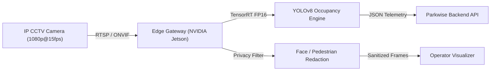

# Phase 08: External Service Requirements & Architecture Specification

## 1. Overview & Operational Status
Phase 08 extends Parkwise into an interconnected, multi-facility ecosystem with 15 advanced enterprise modules. 

> [!IMPORTANT]
> **SIMULATION & ARCHITECTURAL READINESS NOTICE:**
> Computer vision (YOLOv8 occupancy detection), ANPR (Automatic Number Plate Recognition), and WhatsApp booking notifications are currently configured in **Architectural Simulation Mode**. All data structures, API contracts, database schemas, validation layers, and human verification queues are 100% production-ready. Physical hardware (CCTV RTSP streams, NVIDIA Jetson edge accelerators) and live vendor credentials (Meta WhatsApp Cloud API) must be connected using the specifications in this document before production deployment.

---

## 2. Meta WhatsApp Cloud API Integration

### 2.1 Provider Prerequisites
* **Meta Business Manager**: Verified organization account with Indian commercial registration (GSTIN + PAN).
* **WhatsApp Business Platform (Cloud API)**: System user access token with `whatsapp_business_messaging` and `whatsapp_business_management` permissions.
* **Phone Number ID**: Clean, non-personal Indian mobile number (+91) registered under the WABA (WhatsApp Business Account).
* **Webhook Endpoint**: Public HTTPS callback (`https://api.parkwise.in/api/v1/ecosystem/notifications/whatsapp/webhook`) registered with HMAC-SHA256 signature verification.

### 2.2 Template Registry & Approval (MoRTH / Commercial)
The following pre-approved Highly Structured Message (HSM) templates are implemented in Parkwise:
1. `BOOKING_CONFIRMATION`: Driver name, parking lot name, slot number, entry gate, fast navigation URL.
2. `GATE_ACCESS_PASS`: Dynamic 6-character entry passcode + FastTag auto-debit confirmation.
3. `EV_CHARGING_COMPLETE`: Vehicle battery reaches 80% or 100% SoC; 15-minute overstay grace period countdown.
4. `SUBSCRIPTION_RENEWAL`: Monthly pass billing receipt with GST break-up and renewal date.

### 2.3 Environmental Variables (`.env`)
```bash
WHATSAPP_PROVIDER=META_CLOUD_API  # Or MOCK_SIMULATED for local/test
WHATSAPP_API_VERSION=v20.0
WHATSAPP_PHONE_NUMBER_ID=109284729182345
WHATSAPP_ACCESS_TOKEN=EAAG...
WHATSAPP_WEBHOOK_VERIFY_TOKEN=parkwise_wa_verify_token_2026
```

---

## 3. CCTV RTSP Video Streaming Pipeline

### 3.1 Network & Hardware Topology
* **Protocols Supported**: RTSP (`rtsp://username:password@<cctv-ip>:554/stream1`), ONVIF Profile S/T, WebRTC/HLS for browser preview.
* **Camera Specifications**: Minimum 2MP (1080p) @ 15-25 FPS, Varifocal 2.8mm-12mm lens, WDR (Wide Dynamic Range $\ge$ 120dB) for harsh daylight and basement contrast.
* **Bandwidth Provisioning**: 2.5 Mbps dedicated bitrate per camera stream on a segregated VLAN (VLAN 30: Surveillance).



---

## 4. Edge Computer Vision (YOLOv8 & TensorRT)

### 4.1 Deployment Stack
* **Runtime**: NVIDIA JetPack 6.0 / TensorRT 8.6+ running on NVIDIA Jetson Orin Nano (8GB) or Orin NX (16GB) per 8-12 camera cluster.
* **Model Topology**: `yolov8s-parking-v2.engine` optimized with FP16 precision.
* **Inference Budget**: Latency $\le$ 22ms per frame; batch size 4; 99.2% vehicle presence recall.
* **Class Mapping**:
  * Class 0: `CAR`
  * Class 1: `SUV`
  * Class 2: `TWO_WHEELER`
  * Class 3: `EV_CAR` (identifiable by green registration plate / charging port bay alignment)

---

## 5. Indian High Security Registration Plate (HSRP) ANPR & OCR

### 5.1 MoRTH Standard Compliance
Indian motor vehicles use HSRP plates complying with MoRTH Rule 50 of the Central Motor Vehicles Rules (CMVR):
* **Format**: `^[A-Z]{2}[0-9]{1,2}[A-Z]{0,3}[0-9]{4}$` (e.g., `DL 01 AB 1234`, `MH 02 CB 9090`).
* **Chromium Hologram**: 20mm $\times$ 20mm hot-stamped hologram at the top-left corner.
* **Laser Code**: 10-digit PIN laser-etched along the bottom edge.

### 5.2 OCR Engine & Character Confidence Model
* **Primary Engine**: Fine-tuned EasyOCR / Tesseract 5 with specialized Indian HSRP font weights (FE-Schrift modified).
* **Dual-Pass Verification**:
  1. License Plate Localization (YOLO Plate Detector).
  2. Character Recognition + Syntactic Regex Validation.
* **Decision Matrix**:
  * **Score $\ge$ 0.88 + Valid Indian State Code**: Automatic Barrier Gate Lifting (`AUTO_ALLOWED`).
  * **Score $<$ 0.88 or Ambiguous Characters**: Sent immediately to `ANPRHumanReviewQueue` (`HUMAN_REVIEW_REQUIRED`). Gate staff verifies on live tablet within 4 seconds.

---

## 6. Privacy-Conscious Processing Architecture

1. **Edge Face & Pedestrian Redaction**:
   - The edge pipeline applies automated Gaussian blurring or solid black bounding box redaction to all human faces, pedestrians, and adjacent private property before frames leave the edge gateway.
2. **PII Plate Hashing**:
   - For historical analytical logging and audit logs, the raw license plate is cryptographically hashed with salt (`SHA-256(plate + secret_salt)`), preserving user privacy while enabling frequency and duration analysis.
3. **Buffer Zero-Retention**:
   - Unflagged video buffers are discarded from edge RAM within 30 seconds; only structured metadata (timestamp, bay ID, occupancy state) is transmitted to the cloud database.

---

## 7. Multilingual Support (6 Regional Languages)
Parkwise includes localized translation dictionaries for pan-India accessibility:
* **English (`en`)**: Primary administrative language.
* **हिन्दी / Hindi (`hi`)**: Devanagari script for North India (NCR, UP, Bihar, MP, Rajasthan).
* **मराठी / Marathi (`mr`)**: Maharashtra commercial hubs (Mumbai, Pune).
* **ಕನ್ನಡ / Kannada (`kn`)**: Karnataka tech corridor (Bengaluru, Mysuru).
* **తెలుగు / Telugu (`te`)**: Telangana & Andhra Pradesh (Hyderabad, Cyberabad).
* **தமிழ் / Tamil (`ta`)**: Tamil Nadu automotive & SaaS corridor (Chennai, Coimbatore).
